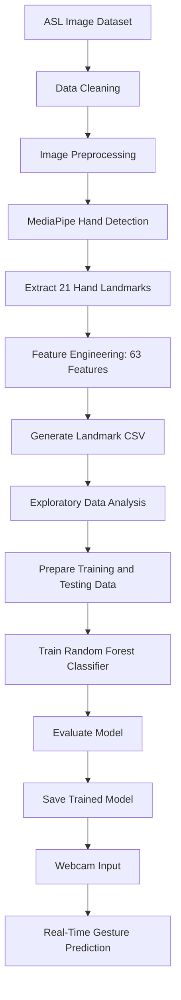

<div align="center">

# 🤟 GestureToText
### Sign Language to Text Converter

<p>
  <b>Bridging communication through Machine Learning 💙</b>
</p>

<p>
  
  
  
  
  
</p>

<p>
  
  
  
</p>

</div>

---

## 🌟 Overview

**GestureToText** is a Machine Learning project that recognizes American Sign Language (ASL) alphabet gestures and converts them into text.

The system uses **MediaPipe** to detect hand landmarks, extracts landmark-based features, and trains a Random Forest classifier to recognize gestures. Real-time predictions are performed using webcam input.

Instead of learning directly from raw images, the system uses numerical hand landmark coordinates, making the recognition pipeline lightweight and suitable for real-time applications.

## ✨ Key Features

- ✋ **Hand Detection:** Detects hand landmarks using MediaPipe.
- 🔢 **63 Landmark Features:** Extracts 21 landmarks with x, y, and z coordinates.
- ⚙️ **Feature Engineering:** Uses wrist-relative coordinate normalization.
- 🧹 **Data Preprocessing:** Handles unreadable images and prepares input data.
- 📊 **Exploratory Data Analysis:** Analyzes dataset structure, missing values, and class distribution.
- 🧠 **Machine Learning:** Trains a Random Forest classifier for gesture recognition.
- 📈 **Model Evaluation:** Uses accuracy, precision, recall, F1-score, and confusion matrix.
- 💾 **Model Persistence:** Saves the trained model for future predictions.
- 📷 **Real-Time Recognition:** Predicts ASL alphabet gestures through a webcam.

---

## 🔄 Project Workflow




---

## 🛠️ Tech Stack

| Category | Technologies |
|---|---|
| Programming Language | Python |
| Computer Vision | OpenCV |
| Hand Landmark Detection | MediaPipe |
| Data Processing | NumPy, Pandas |
| Visualization | Matplotlib |
| Machine Learning | Scikit-learn, Random Forest |
| Model Serialization | Joblib |
| Development | VS Code, Jupyter Notebook |
| Version Control | Git, GitHub |

---

## 🧮 Feature Engineering

GestureToText represents each detected hand using numerical landmark coordinates.

Each hand contains **21 landmarks**, and each landmark has three coordinates:

- `x` — horizontal position
- `y` — vertical position
- `z` — relative depth

**Total features:**

\[
21 \times 3 = 63
\]

The wrist landmark is used as a reference point to calculate relative coordinates. This helps reduce the effect of changes in hand position.

The resulting feature vectors are stored in structured CSV files and used as input for machine learning.

---

## 📂 Project Structure

```text
GestureToText/
│
├── data/
│   ├── Train_Alphabet/
│   └── Test_Alphabet/
│
├── landmarks/
│   ├── TrainLandmarks.csv
│   └── TestLandmarks.csv
│
├── saved_models/
│
├── notebooks/
│
├── src/
│   ├── config.py
│   ├── load_dataset.py
│   ├── data_cleaning.py
│   ├── image_preprocessing.py
│   ├── hand_detection.py
│   ├── feature_engineering.py
│   ├── create_landmarks.py
│   ├── eda.py
│   ├── prepare_data.py
│   ├── train_model.py
│   ├── evaluate_model.py
│   ├── realtime_prediction.py
│   └── main.py
│
├── requirements.txt
├── README.md
└── .gitignore
```

---

## 📚 Dataset

The project uses an American Sign Language alphabet image dataset organized into training and testing folders.

```text
Train_Alphabet/
├── A/
├── B/
├── C/
└── ... Z/

Test_Alphabet/
├── A/
├── B/
├── C/
└── ... Z/
```

Each alphabet folder contains images representing its corresponding gesture. The project processes these images to extract hand landmarks and generate structured training and testing datasets.

---

## 🧠 Machine Learning Pipeline

### 1. Data Preprocessing
- Load training and testing images.
- Remove unreadable or corrupted images.
- Resize images and convert BGR to RGB.
- Detect hands using MediaPipe.

### 2. Landmark Extraction
- Extract 21 hand landmarks.
- Collect x, y, and z coordinates.
- Handle images where a hand cannot be detected.

### 3. Feature Engineering
- Normalize coordinates relative to the wrist.
- Construct 63-dimensional feature vectors.
- Store features and labels in CSV files.

### 4. Model Training
- Load the landmark datasets.
- Separate features and target labels.
- Train a Random Forest classifier.
- Save the trained model using Joblib.

### 5. Evaluation
Evaluate the model using:

- Accuracy
- Precision
- Recall
- F1-score
- Confusion matrix
- Classification report

### 6. Real-Time Prediction
- Capture frames from the webcam.
- Detect and extract hand landmarks.
- Apply the same feature preprocessing used during training.
- Predict the corresponding alphabet using the trained classifier.

---

## 🚀 Getting Started

### Prerequisites

- Python installed
- Git installed
- Webcam for real-time recognition

### 1. Clone the Repository

```bash
git clone https://github.com/archita213V/GestureToText.git
cd GestureToText
```

### 2. Create a Virtual Environment

```bash
python -m venv sign_env
```

Activate it on Windows:

```bash
sign_env\Scripts\activate
```

### 3. Install Dependencies

```bash
pip install -r requirements.txt
```

If your `requirements.txt` is not complete, install the required libraries individually.

### 4. Generate Landmark CSV Files

```bash
python src/create_landmarks.py
```

### 5. Perform Exploratory Data Analysis

```bash
python src/eda.py
```

### 6. Train the Model

```bash
python src/train_model.py
```

### 7. Evaluate the Model

```bash
python src/evaluate_model.py
```

### 8. Run Real-Time Recognition

```bash
python src/realtime_prediction.py
```

> **Note:** These commands assume the listed scripts and their dependencies are implemented as shown in the project structure. Ensure that dataset paths, saved model paths, and script interfaces match your actual code.

---

## 🔮 Future Improvements

- 💬 Combine recognized letters into words and sentences.
- ⌫ Add space, delete, and other text-editing gestures.
- 🔊 Integrate text-to-speech functionality.
- 🌐 Develop a web-based interface.
- 📱 Build a mobile application.
- 🤖 Explore deep learning approaches.
- 🤟 Extend recognition to dynamic sign language gestures.
- 📈 Improve robustness across different lighting conditions and hand positions.

---

## 🌍 Applications

- Accessibility and communication assistance
- Sign language learning tools
- Educational applications
- Human-computer interaction
- Assistive technology solutions

---

## 👩‍💻 Author

<div align="center">

### Archita Verma

🎓 B.Tech Computer Science and Engineering  
💡 Machine Learning Enthusiast

<a href="https://github.com/archita213V">
  
</a>
<a href="https://www.linkedin.com/in/archita-verma-b140282bb">
  
</a>

</div>

---

<div align="center">

⭐ **If you find this project interesting, consider starring the repository!**

*Built with Python, Computer Vision, and Machine Learning 💙*

</div>
